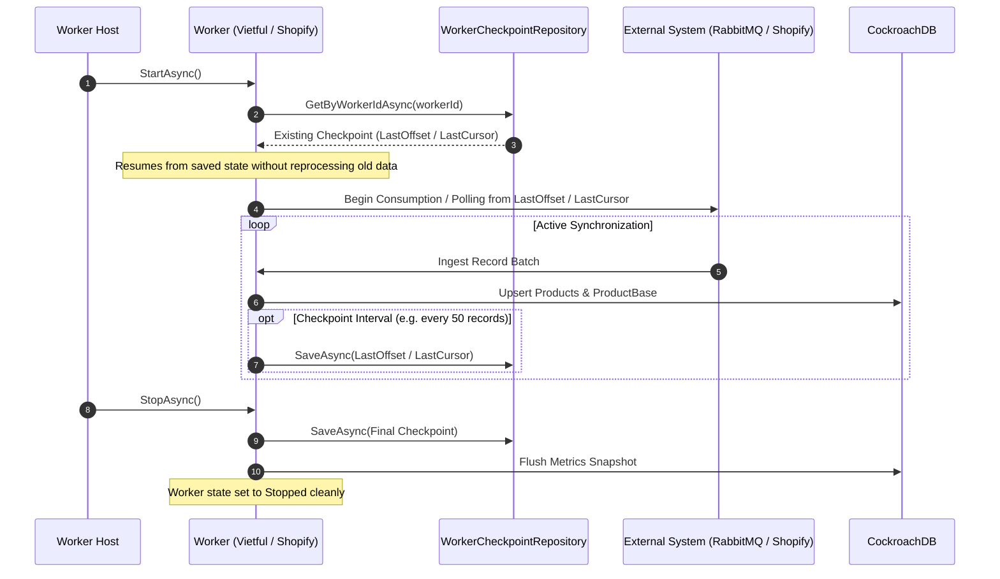
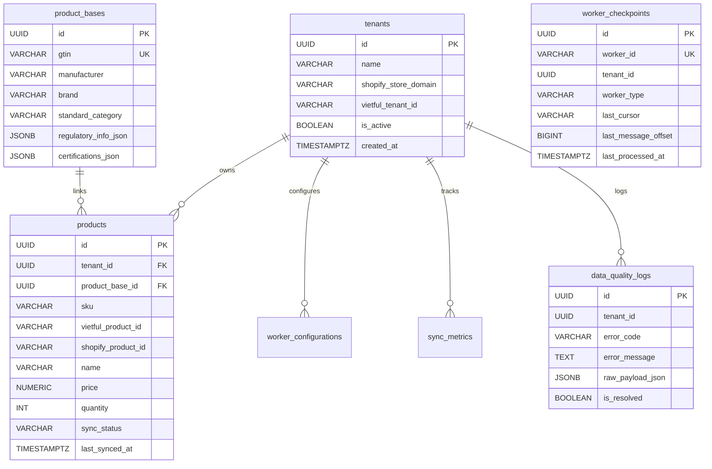

# Change Data Management System (CDMS)

[](https://dotnet.microsoft.com/)
[](https://www.cockroachlabs.com/)
[](https://www.rabbitmq.com/)
[](https://www.docker.com/)

A cloud-native, multi-tenant **Change Data Management System (CDMS)** developed in **C# (.NET 8)**. CDMS synchronizes inventory and product data from heterogeneous data sources into a unified single view backed by a distributed **CockroachDB** / PostgreSQL cluster.

---

## Table of Contents

1. [Executive Summary & Problem Statement](#1-executive-summary--problem-statement)
2. [High-Level Architecture](#2-high-level-architecture)
3. [Core Capabilities & Requirements Matrix](#3-core-capabilities--requirements-matrix)
4. [Data Sources & Ingestion Modes](#4-data-sources--ingestion-modes)
5. [Connectors & Resumable Workers](#5-connectors--resumable-workers)
6. [Shared Master Product Catalog (Cross-Tenant)](#6-shared-master-product-catalog-cross-tenant)
7. [Mock Services & Fault Injection (Bad Data Scenarios)](#7-mock-services--fault-injection-bad-data-scenarios)
8. [Performance Metrics & SLA Monitoring](#8-performance-metrics--sla-monitoring)
9. [Database Design & CockroachDB Cluster](#9-database-design--cockroachdb-cluster)
10. [Cloud Deployment & Operations (Docker & K8s)](#10-cloud-deployment--operations-docker--k8s)
11. [Development Setup](#11-development-setup)
12. [Quick Start & Demonstration](#12-quick-start--demonstration)
13. [REST API Reference](#13-rest-api-reference)

---

## 1. Executive Summary & Problem Statement

Modern e-commerce and retail supply chains require synchronizing inventory across diverse systems:
- **Vietful Inventory Service**: Pushes inventory and catalog updates in near real-time via event messaging.
- **Shopify Stores**: Requires scheduled polling via Admin GraphQL API with cursor pagination and rate-limit handling.

### The CDMS Solution:
1. **Multi-Tenant Isolation**: Supports multiple tenants with individual API credentials, custom polling schedules, and dedicated queues.
2. **Resumable Workers**: Workers track progress via persistent checkpoints (message offset for Vietful, pagination cursor for Shopify), guaranteeing zero data loss across restarts.
3. **Unified Tenant View**: Combines external schemas into a normalized, single-pane inventory view.
4. **Master Product Catalog (`ProductBase`)**: Automatically deduplicates and stores manufacturer, regulatory compliance (FDA, CE, Vietnam DKSP), and certification data across all tenants.
5. **Quality Gates & Dead Lettering**: Intercepts malformed or invalid records and routes them to a dedicated Data Quality registry without stopping sync pipelines.

---

## 2. High-Level Architecture

```mermaid
flowchart TD
    subgraph Sources["External Data Sources"]
        VF["Vietful Inventory Service<br/>(Push via RabbitMQ)"]
        SP["Shopify Admin API<br/>(Pull via GraphQL)"]
    end

    subgraph Messaging["Message Transport"]
        RMQ["RabbitMQ Topic Exchange<br/>vietful.events<br/>+ Dead Letter Exchange (DLX)"]
    end

    subgraph CDMSWorkers["CDMS Worker Engine (C# .NET 8)"]
        VFW["VietfulPushWorker<br/>- RabbitMQ Consumer<br/>- Sequence Deduplication<br/>- Checkpoint Manager"]
        SPW["ShopifyPullWorker<br/>- GraphQL Poller<br/>- Cursor Pagination<br/>- 429 Backoff Handler"]
    end

    subgraph CoreEngine["Validation & Normalization Pipeline"]
        VAL["Data Validation Service<br/>- Schema constraints<br/>- Business rules<br/>- Price & Barcode checks"]
        MAP["Product Mapping Service<br/>- Tenant Product View<br/>- Master ProductBase Extractor"]
        MET["Metrics Collector<br/>- Throughput (rec/s)<br/>- P50, P95, P99 Latency<br/>- Error Rates"]
        DQL["Data Quality / DLQ Logger<br/>- Logs invalid payloads<br/>- Root cause error codes"]
    end

    subgraph Storage["Distributed SQL Cluster (CockroachDB / PostgreSQL)"]
        DB_TP[("products<br/>(Tenant Inventory View)")]
        DB_PB[("product_bases<br/>(Shared Master Catalog)")]
        DB_CP[("worker_checkpoints<br/>(Resumable State)")]
        DB_MT[("sync_metrics<br/>(Telemetry Windows)")]
        DB_DQ[("data_quality_logs<br/>(Bad Data Registry)")]
    end

    subgraph API["CDMS Management REST API"]
        CTRL["Tenants, Workers,<br/>Products & Metrics APIs"]
    end

    VF -->|Near Real-Time Events| RMQ
    RMQ -->|Topic Consumption| VFW
    SP -->|GraphQL Queries (after: cursor)| SPW

    VFW --> VAL
    SPW --> VAL

    VAL -->|Valid Records| MAP
    VAL -->|Invalid Records| DQL

    MAP -->|Upsert Inventory| DB_TP
    MAP -->|Upsert Master Info| DB_PB
    DQL -->|Record Anomaly| DB_DQ

    VFW -->|Save Message Offset| DB_CP
    SPW -->|Save Page Cursor| DB_CP

    VFW -.->|Latency Samples| MET
    SPW -.->|Latency Samples| MET
    MET -->|Flush 60s Windows| DB_MT

    CTRL --> DB_TP
    CTRL --> DB_PB
    CTRL --> DB_MT
    CTRL --> DB_CP
    CTRL --> CDMSWorkers
```

---

## 3. Core Capabilities & Requirements Matrix

| Requirement | Implementation in CDMS | File Location |
|-------------|------------------------|---------------|
| **Multi-Tenancy** | Database tenant isolation, per-tenant worker config & queues | `src/CDMS.Infrastructure/Persistence/` |
| **Vietful Push Ingestion** | Event-driven consumer on RabbitMQ topic exchange | `src/CDMS.Connectors.Vietful/` |
| **Shopify Pull Ingestion** | Scheduled GraphQL client with cursor pagination | `src/CDMS.Connectors.Shopify/` |
| **Start/Stop & Resumption** | Checkpoints persist message offsets and pagination cursors | `WorkerCheckpointRepository.cs` |
| **Shared Product Base** | Deduplicates manufacturer, brand, regulatory data by GTIN | `ProductBaseRepository.cs` |
| **Mock Services** | Full mock APIs for Vietful and Shopify with bad data generators | `mock-services/` |
| **Bad Data Handling** | 6+ fault scenarios caught by validators and routed to DataQualityLog | `DataValidationService.cs` |
| **Telemetry & Metrics** | Real-time calculation of throughput, P50/P95/P99 latency, error rates | `src/CDMS.Metrics/` |
| **Cloud Deployment** | 3-node CockroachDB cluster, RabbitMQ, Docker Compose & Kubernetes | `docker-compose.yml`, `deploy/k8s/` |

---

## 4. Data Sources & Ingestion Modes

### 4.1 Vietful Push (Near Real-Time Event-Driven)
- Vietful pushes inventory events as they occur over RabbitMQ.
- **Topic Exchange**: `vietful.events`
- **Routing Key Pattern**: `tenant.{tenantId}.inventory.product`
- **Envelope**: `MessageEnvelope` with `eventId`, `sequenceNumber`, `timestamp`, `tenantId`, and `payload`.
- **Deduplication**: Incoming sequence numbers are evaluated against `last_message_offset`. Duplicates are skipped.

### 4.2 Shopify Pull (Scheduled Cursor-Based GraphQL)
- Polled on tenant-configured schedules (e.g. every 60s).
- Uses GraphQL query requesting `pageInfo { hasNextPage endCursor }`.
- **Pagination**: Passes `after: $lastCursor` to resume from the exact last edge.
- **Throttling**: Inspects HTTP `429 Too Many Requests` and `Retry-After` headers; applies exponential backoff.

---

## 5. Connectors & Resumable Workers



---

## 6. Shared Master Product Catalog (Cross-Tenant)

When a product is ingested from any tenant, CDMS splits the data into two layers:

1. **`products` (Tenant-Specific)**:
   - Tenant-scoped pricing, stock quantity, localized name/description.
   - Foreign key to `tenants(id)` (CASCADE delete).
2. **`product_bases` (Global Master Record)**:
   - Keyed on universal **GTIN / Barcode**.
   - Contains manufacturer name, country of origin, brand, GS1 standard category.
   - Stores regulatory compliance data (FDA registration, CE mark, Vietnam DKSP) in `regulatory_info_json`.
   - Stores certifications (ISO 9001, HACCP, Organic) in `certifications_json`.
   - Reused across all tenants selling the same physical product.

---

## 7. Mock Services & Fault Injection (Bad Data Scenarios)

Two independent mock services simulate production behaviors and edge cases:

### Vietful Mock Service (`http://localhost:5100`)
- **API Spec**: Matches Vietful REST endpoints (`GET/POST /api/v1/products`).
- **Webhook Simulator**: `POST /api/v1/webhook/simulate` pushes events to RabbitMQ.
- **Fault Scenarios Endpoint**: `POST /api/v1/scenarios/trigger/{scenarioName}`

| Scenario | Trigger Name | Fault Condition | Expected CDMS Behavior |
|----------|--------------|-----------------|------------------------|
| **Missing SKU** | `missing_sku` | `sku = ""` or `null` | Validation fails with `MISSING_SKU`; logged to `DataQualityLog`. |
| **Negative Price** | `negative_price` | `price = -50000` | Rejected with `NEGATIVE_PRICE`. |
| **Invalid Barcode** | `invalid_barcode` | `barcode = "123"` | Rejected with `INVALID_BARCODE`. |
| **Empty Title** | `null_name` | `name = ""` | Rejected with `MISSING_NAME`. |
| **Negative Stock** | `overflow_quantity`| `quantity = -999` | Rejected with `NEGATIVE_QUANTITY`. |
| **Empty JSON** | `empty_payload` | Payload `{}` | Rejected with `JSON_PARSE_ERROR`. |

### Shopify Mock Service (`http://localhost:5200`)
- **GraphQL Endpoint**: `POST /admin/api/2024-01/graphql.json`
- **Rate-Limiting Simulator**: `POST /admin/api/mock/rate-limit?enabled=true` triggers HTTP 429 with `Retry-After: 2`.
- **Fault Scenarios**: `POST /admin/api/mock/inject-bad-data?scenario=empty_title`

---

## 8. Performance Metrics & SLA Monitoring

The `MetricsCollector` captures real-time sync performance without blocking ingestion pipelines:

```
+-------------------------------------------------------------------------------------------------------------+
|                                    CDMS Real-Time Telemetry Snapshot                                        |
+-------------------------------------------------------------------------------------------------------------+
|  Worker Type   |  Processed  |  Invalid  |  Throughput  |  Avg Latency  |  P95 Latency  |  Error Rate | Status   |
+----------------+-------------+-----------+--------------+---------------+---------------+-------------+----------+
|  VietfulPush   |    1,420    |    12     |   124 rec/s  |     8.4 ms    |    14.2 ms    |    0.84%    | Healthy  |
|  ShopifyPull   |      850    |     4     |    75 rec/s  |    32.1 ms    |    58.0 ms    |    0.47%    | Healthy  |
+----------------+-------------+-----------+--------------+---------------+---------------+-------------+----------+
```

### Metrics Tracked:
- **Throughput**: Records processed per second (rolling 60s window).
- **Latency Percentiles**: P50 (median), P95, and P99 latency calculated from sample distributions.
- **Data Freshness**: Time elapsed since the most recent successful sync.
- **Automated Health Alerts**: Flags workers as `Degraded` or `Unhealthy` when P95 latency > 500ms or error rate > 5%.

---

## 9. Database Design & CockroachDB Cluster

CDMS uses a 3-node **CockroachDB** cluster for multi-region resilience, serializable transactions, and distributed SQL scalability.



---

## 10. Cloud Deployment & Operations (Docker & K8s)

### Docker Compose Stack:
- `roach1`, `roach2`, `roach3`: 3-Node CockroachDB cluster with internal gossip protocol.
- `roach-init`: Runs `cockroach init` and applies `001_InitialSchema.sql`.
- `rabbitmq`: RabbitMQ 3.12 message broker with Management UI (`15672`).
- `vietful-mock`: Vietful API & RabbitMQ event publisher (`5100`).
- `shopify-mock`: Shopify GraphQL API & rate limit simulator (`5200`).
- `cdms-api`: Management REST API (`5000`).
- `cdms-workers`: Background synchronization worker daemon.

### Kubernetes Manifests (`deploy/k8s/`):
- `namespace.yaml`, `secrets.yaml`, `configmap.yaml`: Namespace, credentials và shared configuration.
- `cockroachdb-statefulset.yaml`: 3-replica StatefulSet with persistent volume claims.
- `rabbitmq-statefulset.yaml`: Message bus StatefulSet.
- `cdms-api-deployment.yaml`: Horizontal-scalable API deployment with liveness/readiness probes.
- `cdms-workers-deployment.yaml`: Background worker deployment.

A standalone cluster bootstrap script is available at `deploy/cockroachdb/cluster-init.sh` for initializing a CockroachDB cluster outside of Docker Compose.

> **Note:** `roach-init` must complete successfully (`service_completed_successfully`) before `cdms-api` and `cdms-workers` start. To wipe all local state (database volumes, RabbitMQ queues, checkpoints) run `docker compose down -v` and bring the stack up again.

---

## 11. Development Setup

### Prerequisites
- **Docker Desktop** with Docker Compose v2 (for the full stack).
- **.NET 8 SDK** — `global.json` pins SDK `8.0.100` with `rollForward: latestFeature`.
- **PowerShell** — required for `scripts/demo.ps1`.

### Repository Layout
```
cdms-solution/
├── src/
│   ├── CDMS.Core/                  # Domain entities, enums, interfaces, validators, mappers
│   ├── CDMS.Infrastructure/        # EF Core (Npgsql) persistence, RabbitMQ messaging, migrations
│   ├── CDMS.Connectors.Vietful/    # Vietful push worker (RabbitMQ consumer)
│   ├── CDMS.Connectors.Shopify/    # Shopify pull worker (GraphQL poller)
│   ├── CDMS.Metrics/               # Throughput & latency percentile collector
│   ├── CDMS.Workers/               # Worker host daemon + WorkerRegistry
│   ├── CDMS.Api/                   # Management REST API
│   └── CDMS.Tests/                 # xUnit + Moq unit tests
├── mock-services/
│   ├── VietfulMockService/         # Vietful REST API + webhook/RabbitMQ simulator (port 5100)
│   └── ShopifyMockService/         # Shopify GraphQL API + fault injection (port 5200)
├── deploy/
│   ├── cockroachdb/                # cluster-init.sh bootstrap script
│   └── k8s/                        # Kubernetes manifests
├── docs/                           # architecture.md, data-schemas.md
├── scripts/demo.ps1                # End-to-end demonstration script
├── docker-compose.yml              # Full local stack
└── cdms-solution.sln               # Solution file
```

### Build & Test Locally
```powershell
dotnet build cdms-solution.sln
dotnet test cdms-solution.sln
```

The test project (`src/CDMS.Tests`) uses **xUnit** and **Moq** and currently contains 15 unit tests covering validators, product mapping, worker checkpoints, and the worker registry.

### Additional Documentation
- [docs/architecture.md](docs/architecture.md) — Detailed architecture notes.
- [docs/data-schemas.md](docs/data-schemas.md) — Database schemas and message envelope formats.

---

## 12. Quick Start & Demonstration

### Step 1: Start Infrastructure
```bash
docker compose up -d
```

### Step 2: Access Management Interfaces
- **CDMS Swagger UI**: [http://localhost:5000](http://localhost:5000)
- **Vietful Mock Swagger**: [http://localhost:5100](http://localhost:5100)
- **Shopify Mock Swagger**: [http://localhost:5200/swagger](http://localhost:5200/swagger)
- **RabbitMQ Management**: [http://localhost:15672](http://localhost:15672) (guest / guest)
- **CockroachDB Console**: [http://localhost:8080](http://localhost:8080)

### Step 3: Run Automated Demonstration Script
```powershell
./scripts/demo.ps1
```

The script automatically:
1. Registers a test tenant.
2. Injects normal and faulty Vietful messages into RabbitMQ.
3. Tests worker graceful stop and checkpoint verification.
4. Resumes the worker from the checkpoint.
5. Queries real-time throughput and latency percentiles.
6. Inspects the Data Quality error registry.

---

## 13. REST API Reference

| Method | Endpoint | Description |
|--------|----------|-------------|
| `GET` | `/api/tenants` | List all active tenants |
| `POST` | `/api/tenants` | Register a new tenant |
| `GET` | `/api/workers` | List all workers and current states (`Running`, `Paused`, `Stopped`) |
| `POST` | `/api/workers/{id}/start` | Start worker (resumes from checkpoint) |
| `POST` | `/api/workers/{id}/stop` | Gracefully stop worker (saves checkpoint) |
| `GET` | `/api/workers/{id}/checkpoint`| Inspect current checkpoint (`lastCursor`, `lastMessageOffset`) |
| `POST` | `/api/workers/{id}/reset` | Reset checkpoint to force re-sync from beginning |
| `GET` | `/api/products?tenantId={id}`| List normalized products for a tenant |
| `GET` | `/api/products/base/{gtin}` | Query shared master catalog record (manufacturer & regulations) |
| `GET` | `/api/metrics/summary` | Query real-time throughput, P50/P95/P99 latency |
| `GET` | `/api/metrics/errors?tenantId={id}`| List bad-data records and error breakdown |
| `GET` | `/api/metrics/report` | Download formatted Markdown performance report |
| `GET` | `/api/metrics/health` | Check SLA compliance and active health alerts |
