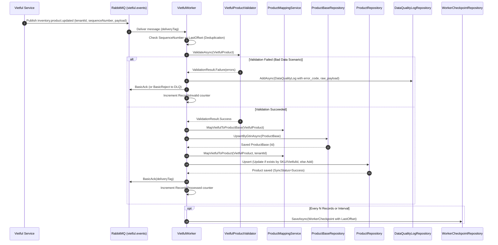
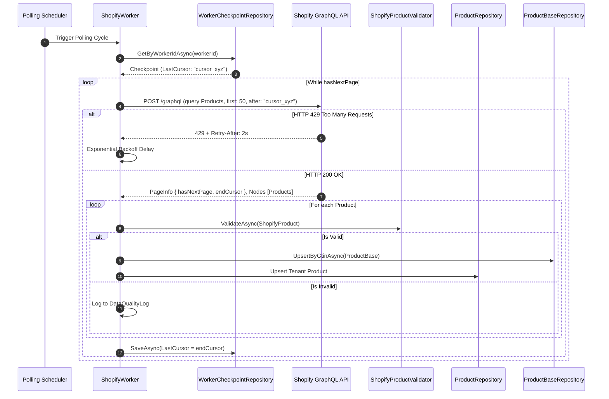
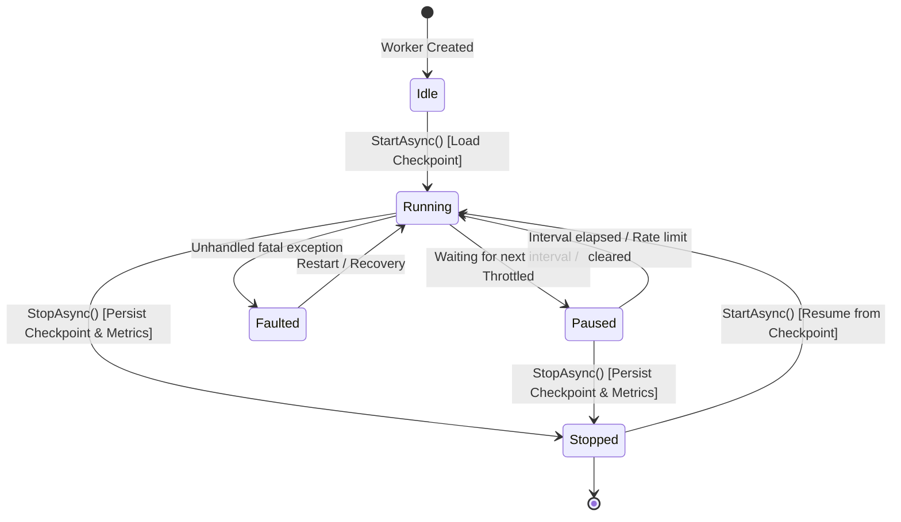

# CDMS Architecture Specification

This document details the architectural design, component interactions, state machines, and resilience strategies of the **Centralised Change Data Management System (CDMS)**.

---

## 1. System Overview & Context

CDMS is a multi-tenant data synchronization platform designed to unify inventory and catalog data across heterogeneous external sources into a single consistent view backed by a distributed SQL cluster (**CockroachDB**).

```mermaid
flowchart TD
    subgraph ExternalSources["External Data Sources"]
        VF["Vietful Inventory Service<br/>(Push via RabbitMQ)"]
        SP["Shopify Admin API<br/>(Pull via GraphQL)"]
    end

    subgraph MessagingLayer["Near Real-Time Messaging"]
        RMQ["RabbitMQ Message Bus<br/>- Exchange: vietful.events (topic)<br/>- Tenant Queues + DLQ"]
    end

    subgraph CDMSCluster["CDMS Cluster (Cloud Native)"]
        subgraph WorkersEngine["CDMS.Workers (Background Engine)"]
            VFW["VietfulPushWorker<br/>- RabbitMQ Consumer<br/>- Deduplication<br/>- Resumable Checkpoint"]
            SPW["ShopifyPullWorker<br/>- GraphQL Poller<br/>- Cursor Pagination<br/>- Rate Limit Throttling"]
        end

        subgraph CorePipelines["Data Processing Pipeline"]
            VAL["Validation Engine<br/>(Business Rules / Quality Gates)"]
            MAP["Mapping Engine<br/>- Tenant Product<br/>- Master ProductBase"]
            DQL["Data Quality & DLQ Logger"]
            MET["Metrics Collector<br/>(Throughput, P50/P95/P99 Latency)"]
        end

        subgraph ManagementAPI["CDMS.Api (REST & Management)"]
            CTRL["Tenants, Workers,<br/>Products & Metrics APIs"]
        end
    end

    subgraph StorageLayer["Distributed Storage"]
        CDB[("CockroachDB 3-Node Cluster / PostgreSQL<br/>- Multi-tenant Products<br/>- Shared Master ProductBase<br/>- Worker Checkpoints<br/>- Sync Metrics<br/>- Data Quality Logs")]
    end

    VF -->|Near Real-Time Push| RMQ
    RMQ -->|Consume Events| VFW
    SP -->|GraphQL Queries (Cursor)| SPW

    VFW --> VAL
    SPW --> VAL

    VAL -->|Valid| MAP
    VAL -->|Invalid| DQL

    MAP -->|Upsert Product & ProductBase| CDB
    DQL -->|Log Faulty Payload| CDB
    VFW -->|Save Offset Checkpoint| CDB
    SPW -->|Save Cursor Checkpoint| CDB

    VFW -.->|Telemetry| MET
    SPW -.->|Telemetry| MET
    MET -->|Flush Metric Windows| CDB

    CTRL -->|Read/Write| CDB
    CTRL -->|Manage Lifecycle| WorkersEngine
```

---

## 2. Sequence Diagrams

### 2.1 Vietful Push Flow (Near Real-Time Event-Driven)



### 2.2 Shopify Pull Flow (Cursor-Based Scheduled Pagination)



---

## 3. Worker State Machine & Resumption

Workers implement strict state machine transitions and persist checkpoints so they can stop and resume without data gaps or redundant reprocessing.



### Resumption Mechanics

| Worker Type | Checkpoint Attribute | Resumption Strategy |
|-------------|----------------------|---------------------|
| **VietfulPush** | `LastMessageOffset` / `SequenceNumber` | Loads last processed sequence number. Any incoming message with `sequenceNumber <= LastOffset` is detected as duplicate and safely acknowledged. |
| **ShopifyPull** | `LastCursor` | Passes `after: LastCursor` to Shopify GraphQL query. Fetches only new/modified pages from the exact stopping point. |

---

## 4. Multi-Tenant Master Catalog Architecture

To satisfy the requirement that basic product information (manufacturers, standard regulations, certifications) is stored regardless of which tenant sells it:

1. **`product_bases` (Global Master Catalog)**:
   - Keyed on natural unique identifier `GTIN` / Barcode.
   - Independent of tenant IDs.
   - Stores: Manufacturer, Country of Origin, Brand, GS1 Standard Categories, Regulatory Compliance JSON, Certifications JSON.
   - When Tenant A syncs SKU-100 with barcode `8934673123456`, a master record is created/updated.
   - When Tenant B syncs the same product under their own SKU, it links to the same `ProductBaseId`.

2. **`products` (Tenant-Specific Inventory)**:
   - Foreign key `tenant_id` (CASCADE delete).
   - Foreign key `product_base_id` (SET NULL).
   - Stores tenant-scoped inventory: `Price`, `Currency`, `Quantity`, `Unit`, tenant-custom descriptions.

---

## 5. Fault Tolerance & Dead Lettering

- **Bad Data Handling**: Instead of crashing the worker or blocking the ingestion queue, invalid data records trigger a `DataQualityLog` entry capturing the offending payload, field name, and specific error code (`MISSING_SKU`, `NEGATIVE_PRICE`, `INVALID_BARCODE`).
- **Dead Letter Exchange (DLQ)**: RabbitMQ queues are provisioned with `x-dead-letter-exchange: vietful.events.dlx`. Malformed or unparseable messages are rejected and routed to dedicated DLQs for operator analysis.
- **Circuit Breaker & Backoff**: Shopify rate limits (`429`) trigger exponential backoff respecting the `Retry-After` HTTP header.
