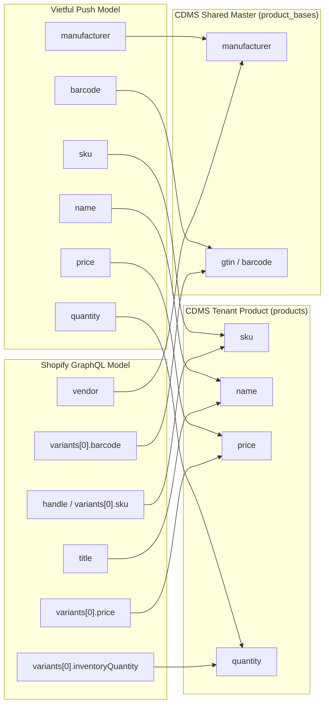

# CDMS Data Schemas & Mapping Specifications

This document defines the schema contracts for external sources (**Vietful Inventory Service** and **Shopify GraphQL**) and their transformation into **CDMS Domain Entities**.

---

## 1. External Schema: Vietful Inventory Service

Source: [Vietful Products API](https://ext.stg.vnfai.com/doc/index.html#tag/Products)

### Schema Definition (JSON)

```json
{
  "id": "string (unique platform ID)",
  "sku": "string (required, max 128 chars)",
  "name": "string (required, max 512 chars)",
  "description": "string (optional)",
  "price": "number (decimal >= 0)",
  "currency": "string (default: VND)",
  "quantity": "integer (>= 0)",
  "unit": "string (e.g., pcs, box, kg)",
  "category": "string (hierarchical category path)",
  "brand": "string (brand name)",
  "manufacturer": "string (manufacturer name)",
  "countryOfOrigin": "string (ISO 2-letter country code)",
  "barcode": "string (GTIN-8, GTIN-12, GTIN-13, EAN-13)",
  "images": [
    { "id": "string", "url": "string (valid http/https URL)" }
  ],
  "attributes": [
    { "name": "string", "value": "string" }
  ],
  "tenantId": "string (tenant identifier)",
  "createdAt": "string (ISO 8601)",
  "updatedAt": "string (ISO 8601)"
}
```

---

## 2. External Schema: Shopify Admin GraphQL

Source: [Shopify Admin GraphQL Product](https://shopify.dev/docs/api/admin-graphql/latest/objects/Product)

### Schema Definition (GraphQL Node)

```graphql
type Product {
  id: ID! # e.g., "gid://shopify/Product/123456789"
  title: String!
  handle: String!
  descriptionHtml: String
  productType: String
  vendor: String
  tags: [String!]!
  status: ProductStatus! # ACTIVE, DRAFT, ARCHIVED
  createdAt: DateTime!
  updatedAt: DateTime!
  variants(first: 10): ProductVariantConnection!
  images(first: 5): ImageConnection!
  metafields(first: 10): MetafieldConnection!
}

type ProductVariant {
  id: ID!
  title: String!
  sku: String
  price: Decimal!
  inventoryQuantity: Int!
  barcode: String
}
```

---

## 3. CDMS Internal Schemas

### 3.1 `products` (Tenant Inventory View)

| Column | Type | Constraints | Description |
|--------|------|-------------|-------------|
| `id` | `UUID` | PK, DEFAULT `gen_random_uuid()` | CDMS Internal Product Identifier |
| `tenant_id` | `UUID` | FK -> `tenants(id)` ON DELETE CASCADE | Owning Tenant ID |
| `product_base_id` | `UUID` | FK -> `product_bases(id)` ON DELETE SET NULL | Reference to shared master catalog |
| `sku` | `VARCHAR(128)` | NOT NULL | Stock Keeping Unit |
| `vietful_product_id`| `VARCHAR(256)`| NULLABLE | External Vietful Product ID |
| `shopify_product_id`| `VARCHAR(256)`| NULLABLE | External Shopify Product GID |
| `shopify_variant_id`| `VARCHAR(256)`| NULLABLE | External Shopify Variant GID |
| `name` | `VARCHAR(512)` | NOT NULL | Standardized display name |
| `description` | `TEXT` | NULLABLE | Description (HTML/Text) |
| `price` | `NUMERIC(18,4)`| NOT NULL, DEFAULT 0 | Retail price in tenant currency |
| `currency` | `VARCHAR(8)` | NOT NULL, DEFAULT 'VND'| Currency ISO code |
| `quantity` | `INT` | NOT NULL, DEFAULT 0 | Available inventory |
| `unit` | `VARCHAR(64)` | NULLABLE | Unit of measure |
| `category` | `VARCHAR(512)` | NULLABLE | Tenant product category |
| `brand` | `VARCHAR(256)` | NULLABLE | Brand name |
| `barcode` | `VARCHAR(64)` | NULLABLE | GTIN / EAN barcode |
| `images_json` | `JSONB` | NULLABLE | Serialized image URLs |
| `attributes_json` | `JSONB` | NULLABLE | Extended attributes key-value |
| `sync_status` | `VARCHAR(32)` | NOT NULL, DEFAULT 'Pending' | Pending, InProgress, Success, Failed, InvalidData |
| `last_synced_at` | `TIMESTAMPTZ`| NULLABLE | Timestamp of last sync |
| `last_sync_error` | `TEXT` | NULLABLE | Error message if failed |
| `created_at` | `TIMESTAMPTZ`| NOT NULL | Audit creation timestamp |
| `updated_at` | `TIMESTAMPTZ`| NOT NULL | Audit update timestamp |

### 3.2 `product_bases` (Shared Master Catalog)

| Column | Type | Constraints | Description |
|--------|------|-------------|-------------|
| `id` | `UUID` | PK | Master Product Identifier |
| `gtin` | `VARCHAR(64)` | UNIQUE (WHERE NOT NULL) | Universal GTIN/Barcode |
| `barcode` | `VARCHAR(128)` | NULLABLE | Alternative barcode |
| `manufacturer` | `VARCHAR(512)` | NULLABLE | Manufacturer company name |
| `country_of_origin` | `VARCHAR(4)` | NULLABLE | ISO country code |
| `brand` | `VARCHAR(256)` | NULLABLE | Master brand |
| `manufacturer_part_number` | `VARCHAR(256)` | NULLABLE | MPN code |
| `standard_category` | `VARCHAR(128)` | NULLABLE | GS1 Category code |
| `standard_category_name` | `VARCHAR(512)` | NULLABLE | GS1 Category name |
| `regulatory_info_json` | `JSONB` | NULLABLE | Regulatory numbers (FDA, CE, DKSP) |
| `certifications_json` | `JSONB` | NULLABLE | Standard certifications (ISO, HACCP) |
| `physical_attributes_json` | `JSONB` | NULLABLE | Weight, dimensions, volume |

---

## 4. Field Mapping Rules


